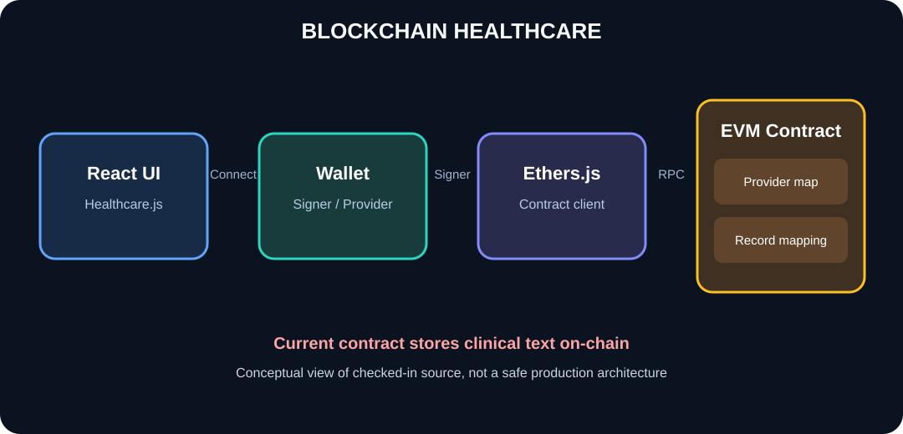
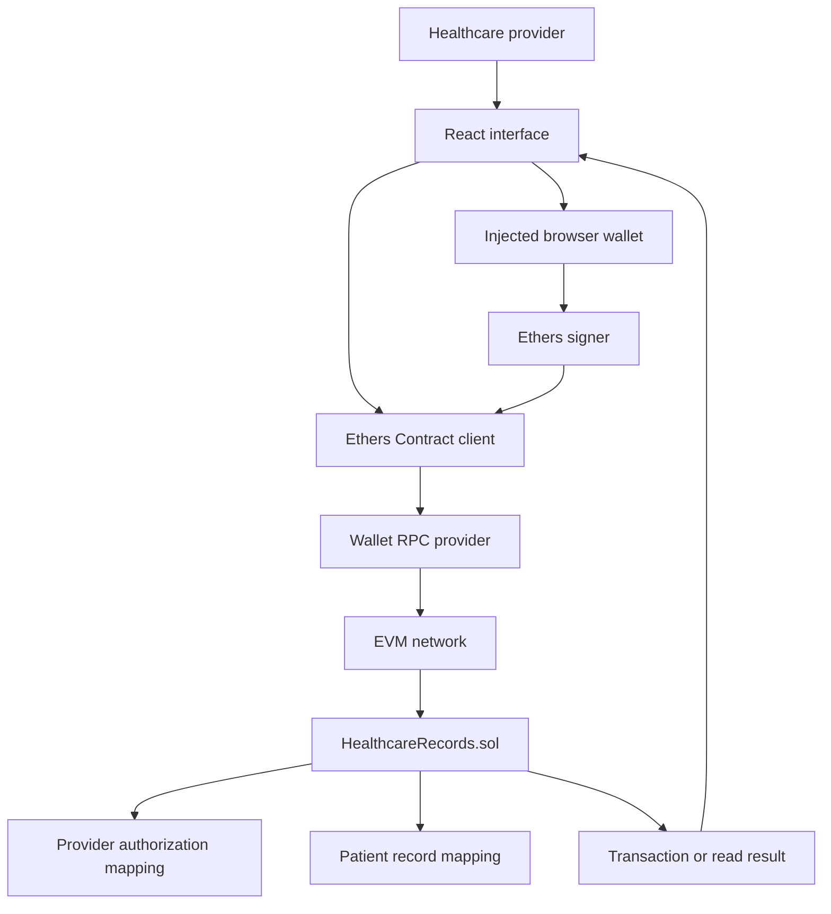

<div align="center">
  
  <h1>🏥 Blockchain Healthcare</h1>
  <p><strong>Ethereum smart-contract and React wallet prototype for healthcare record workflows.</strong></p>
  <p>
    
    
    
    
    
    
  </p>
  <p><a href="#-overview">Overview</a> · <a href="#-architecture">Architecture</a> · <a href="#-quick-start">Quick start</a> · <a href="docs/README.md">Documentation</a></p>
</div>

> [!CAUTION]
> **Do not put real patient data, diagnoses, treatments, names, or medical identifiers into this prototype.** The Solidity contract stores clinical text directly on-chain. Blockchain state is publicly observable and effectively permanent. A Solidity `private` mapping does not provide confidentiality. This project is not suitable for production healthcare or regulated clinical use.

---

## 🌍 Overview

Blockchain Healthcare is a small React application connected to an Ethereum-compatible smart contract using ethers.js v5. It demonstrates wallet connection, contract-owner detection, provider authorization, adding patient records, and retrieving records for a patient ID.

It is a learning prototype, not a complete electronic health record system. It has no backend, off-chain encrypted data store, patient identity verification, key-management service, clinical workflow, consent system, or regulatory compliance controls.

## ✨ Current prototype capabilities

| Capability | Source evidence | Status |
|---|---|---|
| Browser wallet connection | Injected `window.ethereum`, ethers Web3Provider | Implemented, needs robust state/error handling |
| Owner lookup | `getOwner()` contract call | Implemented |
| Provider authorization | Owner-only `authorizeProvider` | Implemented in contract and UI |
| Record creation | `addRecord` called from React | ABI/source mismatch currently blocks reliability |
| Record retrieval | `getPatientRecords` call | Provider-only in contract; ABI mismatch |
| Transaction feedback | React Hot Toast | Basic success/error messages |
| Private clinical storage | No encryption/off-chain data store | Not implemented |
| Patient consent and revocation | No consent model | Not implemented |
| Auditing and emergency response | No formal audit/pause/incident path | Not implemented |
| Accessibility validation | No automated accessibility test | Not yet verified |

## 🧱 Technology stack

- **Frontend:** React 18, Create React App / react-scripts 5.
- **Blockchain client:** ethers.js 5.7.
- **Smart contract:** Solidity 0.8.x.
- **Wallet:** injected Ethereum provider, typically MetaMask-compatible.
- **Feedback:** react-hot-toast.
- **Tests:** React Testing Library and Jest via react-scripts.

## 🖼️ System overview

<p align="center"></p>

## 🏗️ Architecture

The React entry point renders `Healthcare`. The component connects to an injected wallet, gets a signer, constructs a contract client from a configured address and ABI, then calls contract methods. The Solidity contract stores a mapping from numeric patient IDs to arrays of record structs and a mapping of provider addresses to authorization flags.



More detail: [Architecture](docs/architecture.md), [Contract interface](docs/api.md), [Data model](docs/database.md).

## 🚀 Quick start

### Requirements

- Node.js compatible with the existing Create React App toolchain.
- npm.
- Browser with an injected Ethereum wallet.
- A dedicated testnet or local EVM chain.
- A deployed contract compiled from the exact Solidity source used by the frontend.

### Install and launch

```bash
npm ci
npm start
```

The development server normally opens at `http://localhost:3000`.

### Configure the contract before connecting

The current component hardcodes the address in `src/Healthcare.js`. The checked-in `.env.example` is only a proposed configuration template: the application currently does not read those variables.

Before any test call:
1. Compile `Healthcare.sol` with a pinned compiler version.
2. Generate the ABI from that exact compiled artifact.
3. Confirm ABI method signatures and tuple layouts against the deployed bytecode.
4. Configure the correct testnet contract address.
5. Check the wallet chain ID and connected account.
6. Use synthetic test records only.

> [!WARNING]
> The current frontend ABI expects `tests` in `addRecord` and a `tests` field in returned structs. The checked-in Solidity source does not have that field or parameter. The frontend also hardcodes the patient name `Alice`. Do not assume the current write/read flows work correctly until the ABI and UI are reconciled.

See [Installation](docs/installation.md) and [Configuration](docs/configuration.md).

## 🔐 Security and healthcare privacy

This prototype is unsafe for real health information. Directly writing names, diagnoses, and treatments to an immutable public ledger creates a permanent disclosure risk. Access modifiers do not encrypt blockchain state or guarantee confidentiality.

A responsible redesign would keep clinical data encrypted off-chain, minimize on-chain metadata, define an appropriate patient consent and access model, introduce audited key management and revocation, and undergo independent smart-contract, application, privacy, and legal review.

- [Security policy](SECURITY.md)
- [Threat model](docs/threat-model.md)
- [Privacy and data protection](docs/privacy.md)
- [Secure architecture proposal](docs/secure-architecture.md)
- [Incident response](docs/incident-response.md)

## ♿ Accessibility

Accessibility work must cover semantic form labels, keyboard operation, visible focus, color contrast, wallet status announcements, transaction error messages, responsive layout, and non-color status cues.

The existing UI uses placeholder-only inputs without associated visible labels. Accessibility has not been fully tested. See [Accessibility guide](docs/accessibility.md).

## 🧪 Development and quality

```bash
npm test -- --watchAll=false
npm run build
```

The checked-in React test is still the Create React App starter test and does not validate healthcare flows. The current workflows perform dependency, static source, build, and documentation checks where possible. They do not prove contract correctness, deployed-network compatibility, security, clinical suitability, or accessibility conformance.

See [Testing strategy](docs/testing.md) and [QA plan](docs/qa.md).

## 📂 Project structure

```text
Blockchain-Healthcare/
├── Healthcare.sol             # Solidity contract source
├── src/
│   ├── App.js                 # React application shell
│   ├── Healthcare.js          # Wallet and contract interaction UI
│   ├── App.css                # Main UI styles
│   ├── App.test.js             # Current starter test
│   └── index.js               # React bootstrap
├── public/                    # CRA static assets and web manifest
├── docs/                      # Architecture, security, guides and templates
├── .github/                   # Issue forms, PR template and CI
├── package.json               # Scripts and dependencies
└── package-lock.json          # npm dependency lockfile
```

## 🗺️ Documentation index

- [Documentation hub](docs/README.md)
- [Product overview](docs/product-overview.md)
- [Architecture](docs/architecture.md)
- [Smart contract design](docs/smart-contract.md)
- [Contract API](docs/api.md)
- [Data model and storage](docs/database.md)
- [Configuration](docs/configuration.md)
- [Installation](docs/installation.md)
- [Development](docs/development.md)
- [Deployment](docs/deployment.md)
- [Security review](docs/security.md)
- [Threat model](docs/threat-model.md)
- [Privacy](docs/privacy.md)
- [Secure architecture proposal](docs/secure-architecture.md)
- [Accessibility](docs/accessibility.md)
- [Testing strategy](docs/testing.md)
- [QA plan](docs/qa.md)
- [Operations](docs/operations.md)
- [Incident response](docs/incident-response.md)
- [Risk register](docs/risk-register.md)
- [Known issues](docs/known-issues.md)
- [Troubleshooting](docs/troubleshooting.md)
- [Templates](docs/templates/README.md)
- [Diagrams](docs/diagrams/README.md)

## 🤝 Contributing

Read [CONTRIBUTING.md](CONTRIBUTING.md) before submitting changes. Security-sensitive changes require explicit tests, threat analysis, and review. Never attach real health records or private keys to issues or pull requests.

## 📜 License and attribution

The repository includes an MIT license. See [LICENSE](LICENSE). Third-party libraries and tools retain their own licenses. The repository license does not override third-party terms.

<p align="center"><sub>Built as a blockchain and healthcare software learning prototype. Synthetic data only.</sub></p>

Last updated: 2026-11-16 19:27 UTC
