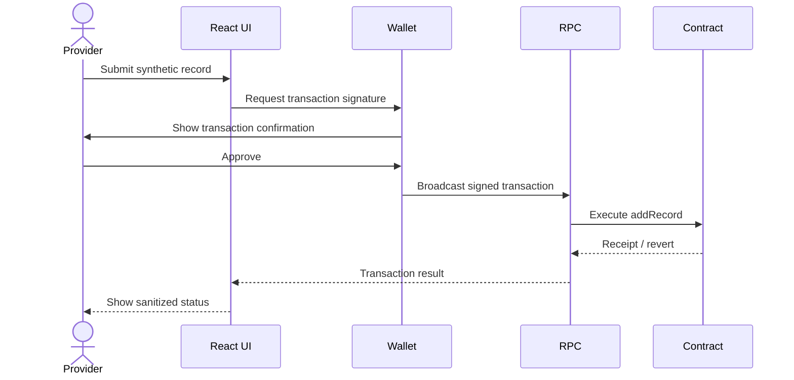

# 🔌 Smart contract interface reference

There is no HTTP/REST API in the repository. The browser frontend calls Solidity methods through ethers.js v5.

## Current contract methods

| Method | Parameters | Returns | Caller |
|---|---|---|---|
| `getOwner` | none | owner address | any account |
| `authorizeProvider` | provider address | transaction | owner only |
| `addRecord` | patient ID, patient name, diagnosis, treatment | transaction | authorized provider |
| `getPatientRecords` | patient ID | array of Record tuples | authorized provider |

## Record tuple

The checked-in Solidity struct order is:
1. `recordID` (uint256)
2. `patientName` (string)
3. `diagnosis` (string)
4. `treatment` (string)
5. `timestamp` (uint256)

The frontend ABI currently describes a different tuple containing `tests`. Do not rely on tuple indexes or named properties until the ABI is regenerated from the deployed artifact.

## Transaction lifecycle

## Error handling expectations

- Wallet missing or locked.
- User rejects signature.
- Wrong chain ID.
- Contract address has no code.
- ABI does not match deployed bytecode.
- Provider not authorized.
- RPC/network unavailable.
- Transaction reverts or remains pending.

Never display clinical text or sensitive revert data in public logs.
