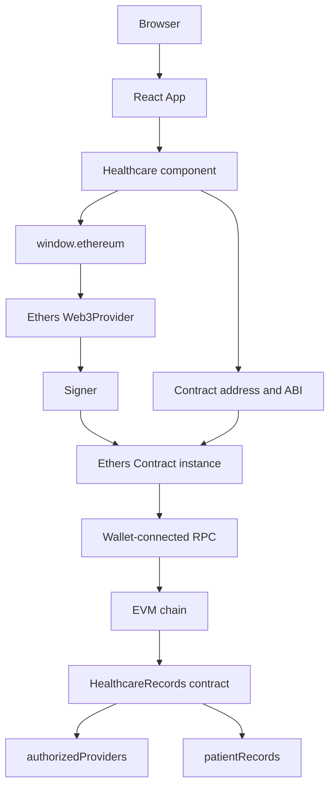

# 🏗️ System architecture

## 1. Architectural style

The current repository is a browser-only React application calling an EVM smart contract through an injected wallet. There is no trusted backend in the current design.

## 2. Components

| Component | Source | Responsibility | Limitations |
|---|---|---|---|
| React app shell | `src/App.js` | Renders healthcare component | Minimal routing/state boundary |
| Healthcare UI | `src/Healthcare.js` | Wallet connect, calls, form state, records display | Address/ABI hardcoded; literal patient name; no robust lifecycle handling |
| Ethers provider | ethers v5 | Connects to injected wallet RPC | Network switching and account events not fully handled |
| Signer | Wallet signer | Signs authorized transactions | User confirmation is required; never request/export keys |
| Contract | `Healthcare.sol` | Provider authorization and record mapping | Stores sensitive text publicly; no revocation/pause |
| EVM network | Selected wallet chain | Persists state and transaction history | Public/immutable by design |

## 3. Runtime interaction

## 4. Trust boundaries

- Browser UI to injected wallet: the wallet controls signing and account permissions.
- Frontend to wallet RPC: reads and transactions depend on the selected chain and provider.
- Contract caller to Solidity modifiers: authorization is based on `msg.sender`.
- On-chain state to all chain observers: clinical text is not confidential.

## 5. Architectural gaps

The frontend currently treats an injected provider as available without first checking for it. It does not subscribe to account or chain changes. The ABI stored inline is not synchronized with the Solidity source. There is no off-chain encryption, key management, patient consent, provider revocation, event-driven audit index, or recovery service.

## 6. Recommended boundary for a safer redesign

A future design should keep clinical data off-chain, encrypted under controlled keys, and avoid placing direct identifiers or clinical text on-chain. The chain should only hold carefully reviewed minimal references or integrity commitments. This is a proposal, not current functionality.
