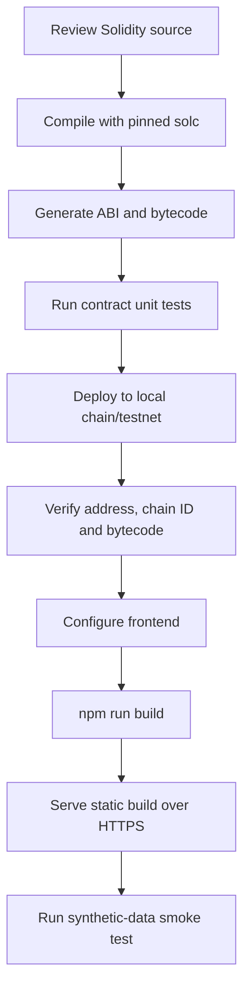

# 🚢 Deployment guide

## Current prototype deployment model

The React app can be built with Create React App and served as static assets. The Solidity contract must be deployed independently to a chosen EVM network. The frontend needs the matching contract address, ABI, and chain ID.

## Testnet workflow



## Frontend build

```bash
npm ci
npm run build
```

The generated `build/` directory can be served by a static hosting provider configured for HTTPS. If client-side routes are added, configure SPA fallback.

## Smart contract deployment safeguards

- Do not deploy the current plaintext clinical data model for real records.
- Verify compiler version, optimizer settings, source hash, and ABI.
- Verify the owner address and test provider authorization.
- Record chain ID and contract address in release notes.
- Use a dedicated deployer wallet.
- Have access control, upgradeability assumptions, pause/recovery, and key custody reviewed.
- Obtain independent security and privacy review before any sensitive use.
