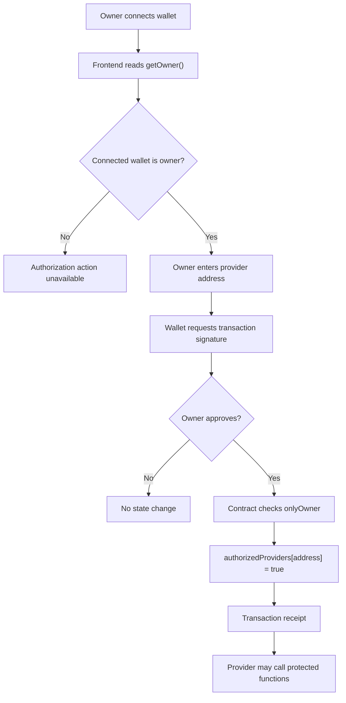

# 🔐 Provider authorization flow

## Current limitation

The contract supports granting authorization but does not provide a function to revoke it. The React UI has no verified provider status listing or lifecycle management. Do not treat this as a complete provider onboarding/offboarding system.
