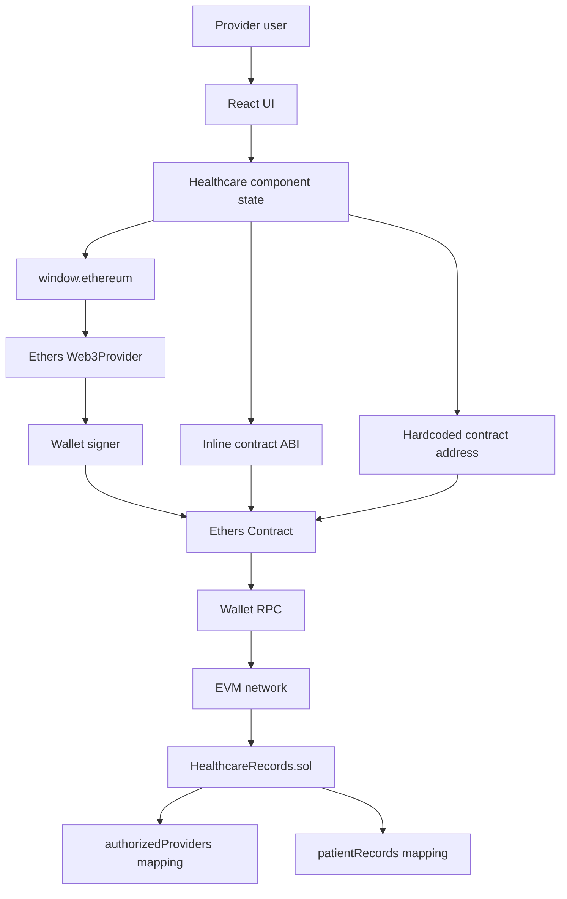

# 🏗️ Current application architecture

## Important boundaries

The browser contains UI state, not a trusted authorization authority. The Solidity contract enforces owner/provider modifiers for protected methods. Public blockchain state is observable even where Solidity variables are marked private.

The frontend/contract ABI mismatch is a current known issue.
