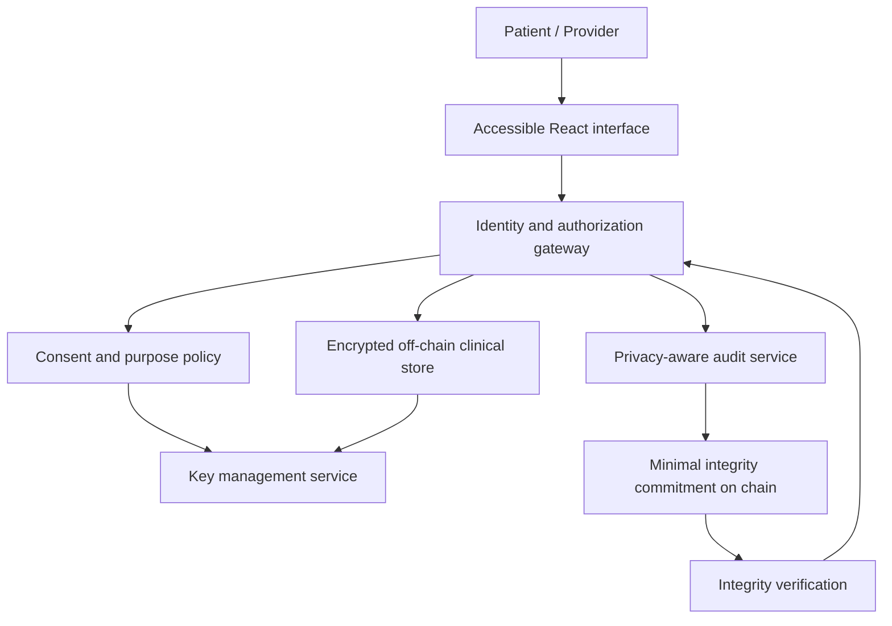

# 🧱 Proposed secure architecture

**This architecture is proposed only.** It is not implemented by the current frontend or Solidity contract. The contract should not store names, diagnoses, treatments, or direct identifiers.
