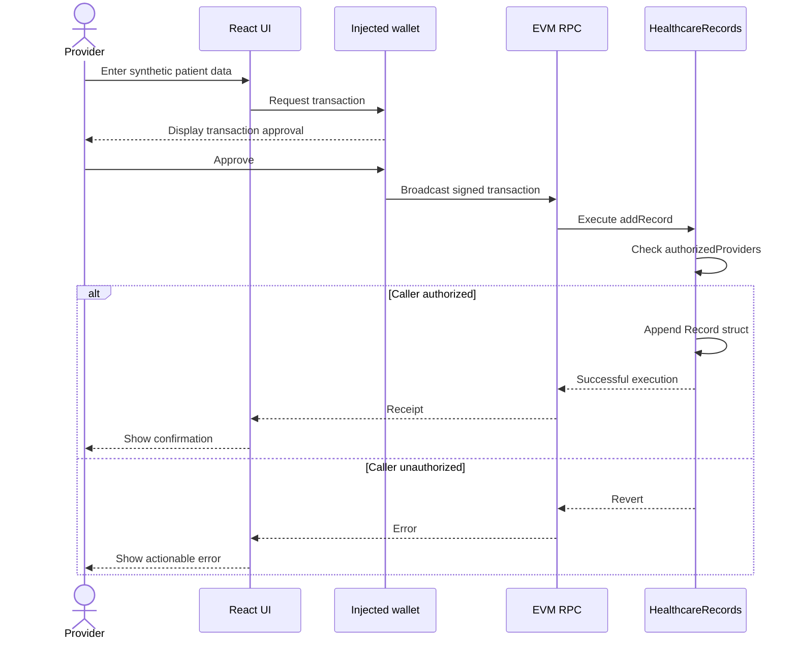

# 🔁 Provider transaction sequence

This represents the intended call lifecycle. The checked-in frontend ABI does not currently match the checked-in contract source, so this flow is not verified end-to-end.
