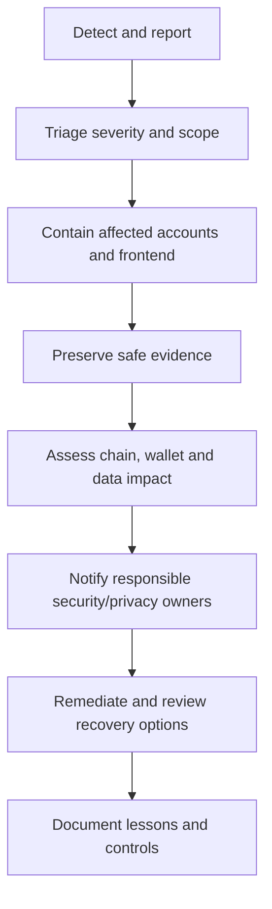

# 🚨 Incident response

## Trigger examples

- Clinical information accidentally written on-chain.
- Owner or provider wallet compromised.
- Unauthorized provider activity.
- Frontend points to an unexpected contract/network.
- Malicious frontend package or compromised deployment.
- Private keys, seed phrases or service credentials exposed.

## Response sequence

## Critical privacy reality

Data already included in public blockchain transactions or state cannot be reliably deleted. Do not promise erasure after an on-chain disclosure. Escalate promptly to qualified security/privacy/legal professionals and follow applicable notification obligations.

## Evidence handling

Record the network, contract address, block/transaction references, affected wallet addresses and time window. Do not copy sensitive clinical values into tickets or public reports.
