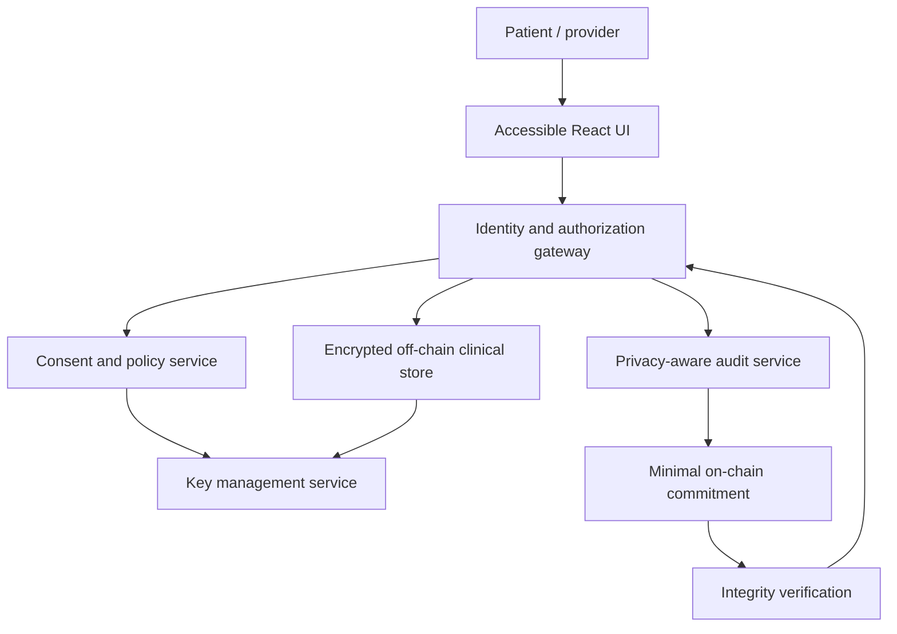

# 🧱 Proposed safer architecture

> **Proposal only. Not implemented in the repository.** This design avoids putting clinical text or direct identifiers on a public blockchain.

## Design goals

- Clinical data remains off-chain and encrypted.
- Chain state contains only minimal, reviewed integrity/access references.
- Patient consent and provider authorization are explicit and revocable.
- Key access is auditable and recoverable under a reviewed policy.
- Blockchain outages do not destroy access to the authoritative medical record.
- Patients have a non-blockchain alternative and accessible interfaces.

## Proposed components

| Component | Responsibility |
|---|---|
| Patient identity service | Verified identities and identifier mapping |
| Consent/policy service | Purpose, scope, expiry and revocation |
| Clinical record store | Encrypted off-chain records |
| Key management service | Key generation, rotation, access and recovery |
| Authorization gateway | Checks provider identity and consent before retrieval |
| Smart contract | Minimal integrity commitments or access-policy anchors |
| Audit service | Tamper-evident access history without leaking clinical content |
| React frontend | Accessible, wallet-aware user interface |

## Proposed data flow

## Important design cautions

- A hash is not automatically anonymous.
- Encryption does not solve key recovery, compromised endpoints, or authorized misuse.
- Public blockchain events can reveal timing and relationships.
- Smart-contract access control does not secure off-chain storage by itself.
- The architecture requires independent cryptographic, application, privacy and legal review.
