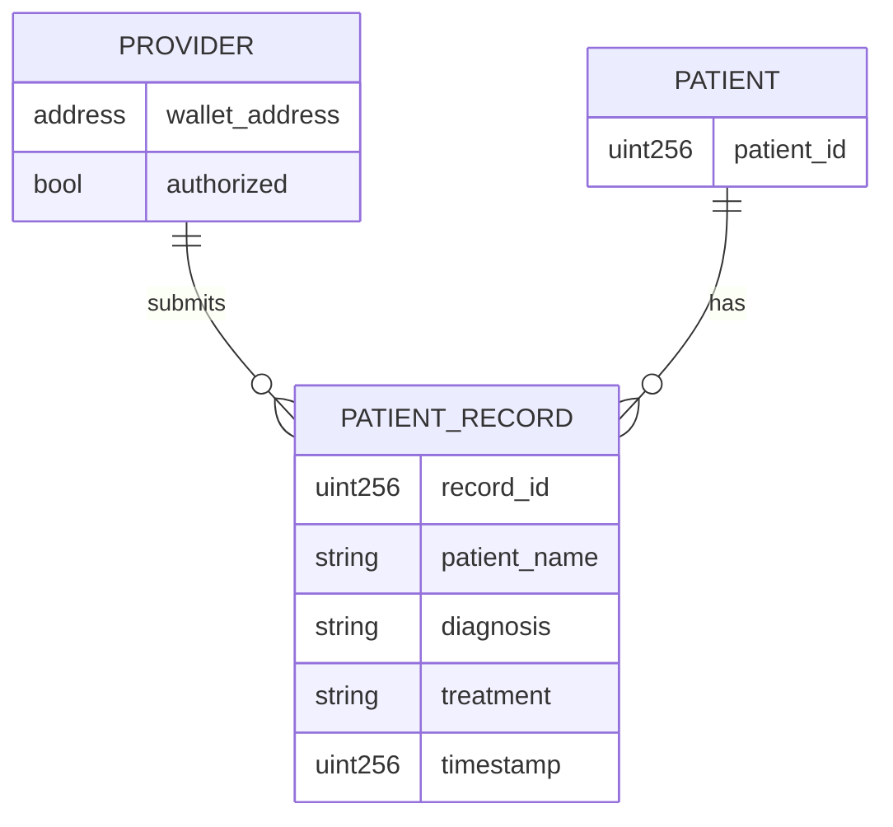

# 📜 Smart contract design

## Contract: HealthcareRecords

The checked-in `Healthcare.sol` declares Solidity `^0.8.0` and contains:
- An `owner` address set to the deployer in the constructor.
- A `Record` struct with record ID, patient name, diagnosis, treatment, timestamp.
- A mapping from numeric patient ID to an array of records.
- A mapping from provider address to authorization boolean.
- `onlyOwner` and `onlyAuthorizedProvider` modifiers.

## Method behavior

| Method | Mutability | Access | Effect |
|---|---|---|---|
| constructor | Nonpayable | Deployment | Sets deployer as owner |
| `getOwner()` | View | Public | Returns owner address |
| `authorizeProvider(address)` | Nonpayable | Owner | Sets provider authorization to true |
| `addRecord(...)` | Nonpayable | Authorized provider | Appends a record |
| `getPatientRecords(uint256)` | View | Authorized provider | Returns the record array |

## Current data layout

## Security and privacy weaknesses

- Record fields contain identifying and clinical text directly on-chain.
- Solidity visibility `private` only restricts contract-level accessors, not blockchain observability.
- There is no provider deauthorization method.
- There is no patient consent or patient-controlled sharing.
- There are no record correction, deletion, or expiration semantics.
- Array growth creates storage and gas costs that grow with every record.
- No input length, format, or semantic validation is present.
- No events are emitted for authorization or record creation.

## Frontend ABI mismatch

The React ABI includes a `tests` argument for `addRecord` and a `tests` component in the returned tuple. The checked-in Solidity contract has neither. Compile the exact source and regenerate the ABI before connecting.

## Required contract test matrix

- Only owner can authorize.
- Non-owner authorization reverts.
- Authorized provider can submit.
- Unauthorized address cannot submit or read.
- Record IDs increment as expected.
- Timestamp is populated.
- Empty/invalid patient IDs and oversized strings are handled according to an explicit policy.
- Authorization revocation and ownership transfer are not supported by the current contract and need explicit design before production consideration.

Do not deploy this contract with real clinical information.
