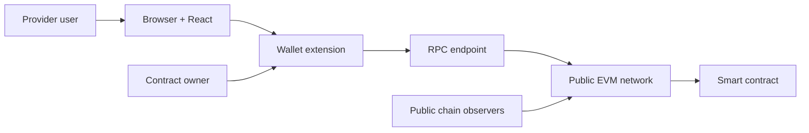

# 🧨 Threat model

## Assets

- Patient identity and clinical details.
- Patient-to-record association.
- Provider authorization state.
- Wallet addresses and transaction history.
- Contract ownership and deployment keys.
- Frontend configuration and ABI.
- User trust and availability of record workflows.

## Threat actors

- Curious chain observers.
- Malicious or compromised provider.
- Compromised browser extension or device.
- Malicious frontend dependency or injected script.
- Unauthorized user attempting contract calls.
- Compromised deployer/owner wallet.
- RPC/network provider outage or manipulation.

## Trust boundaries

## Threat scenarios and controls

| Threat | Impact | Required controls |
|---|---|---|
| Public state inspection | Clinical data disclosure | Never write PHI on-chain; encrypted off-chain architecture |
| Stolen provider wallet | Unauthorized record access/actions | Hardware-backed custody, session hygiene, revocation and monitoring |
| Stolen owner wallet | Unauthorized provider authorization | Multisig, hardware wallet, delayed governance and alerts |
| Wrong network/address | Calls to unexpected contract | Chain/address allowlist, bytecode verification, UI confirmation |
| ABI mismatch | Failed or incorrect call decoding | Artifact-generated ABI and integration tests |
| Malicious frontend/dependency | Wallet phishing or data exfiltration | Dependency review, CSP, build integrity and origin controls |
| RPC outage | Workflow unavailable | Provider fallback and clear fail-safe UI |
| Data correction request | Permanent incorrect data remains | Off-chain authoritative records and correction workflow |

## Current controls and gaps

The contract has owner/provider modifiers. These are not confidentiality protections. There is no provider revocation, patient consent, encrypted data layer, multisig ownership, monitoring, or emergency pause.
